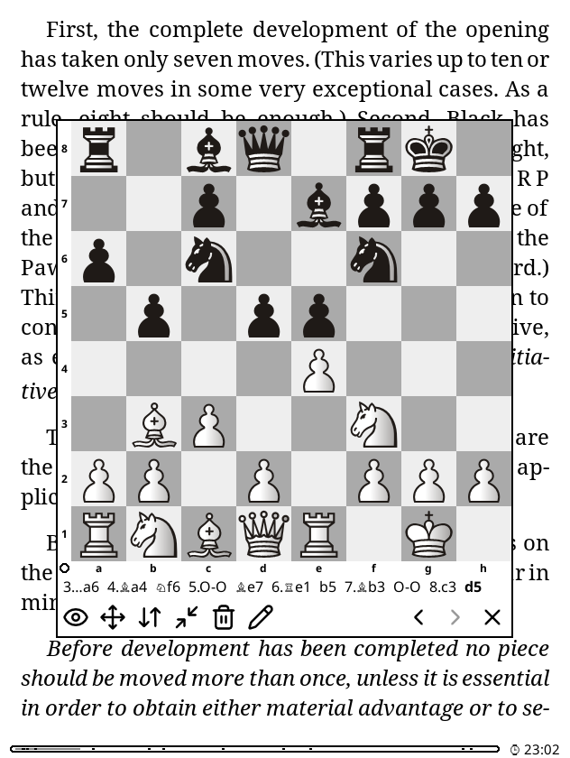
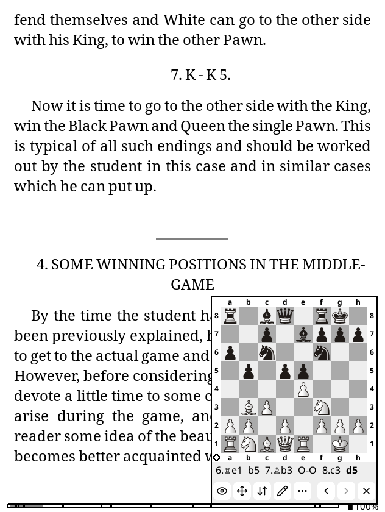
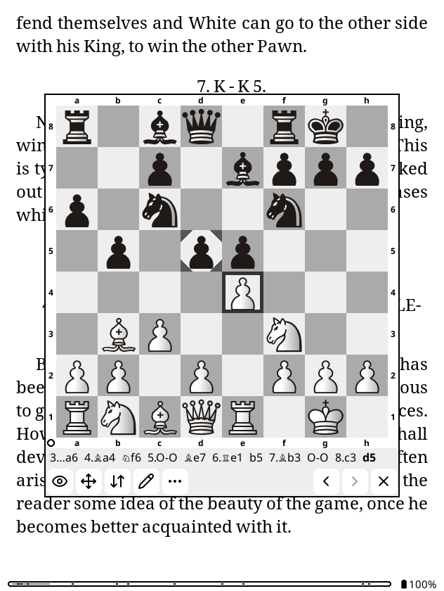
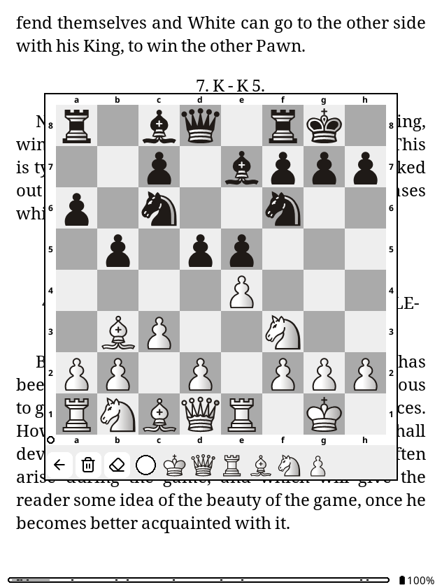

# Chess Board (`chessboard.koplugin`)

A KOReader plugin for reading chess books: an interactive board that floats **over the page of the book**, so you can follow the games and try variations without leaving the reading.

> **Still in development.** It works, but some features are missing and there may be bugs. Found a bug or want a feature? Open an issue at https://github.com/FelipeMarelli/chessboard.koplugin/issues — every report helps.

 

## Features

- **Floating board over the book**: it does not cover the reader; taps outside the window turn pages and follow links as always.
- **Legal moves only**: tap a piece and its targets are marked; castling, en passant, promotion, check, mate and stalemate.
- **The line of moves**: a strip under the board shows the moves played in book notation, with figurines and the current move in bold. Step back and forward, or jump to the start and the end.
- **Try variations**: go back and play another move; the rest of the line is replaced.
- **Position editor**: set up any position from the book, with the side to move; castling rights are deduced from the pieces.
- **Move and resize**: drag the window anywhere and make it as small or big as you like.
- **Made for e-ink**: plain gray squares, sharp Merida pieces at any size, marks that differ by shape and not only by tone, and minimal screen refreshes.
- **Portrait and landscape.**
- **English and Spanish.**

 

## Install

From Storefront or AppStore, searching for "Chess Board". Or by hand: copy the `chessboard.koplugin` folder to `koreader/plugins/` on the reader and restart KOReader.

Developed and tested on KOReader v2026.07.1, on a Kindle Paperwhite.

## Use

With a book open, the board opens and closes from the reader menu, under Tools › More tools › "Chess board".

- **Play**: tap a piece, then the target square.
- **Walk the line**: the arrows go back and forward one move; held down, they go to the start and the end.
- **Move and resize**: drag the move button to take the window somewhere else; the size button makes it smaller or bigger.
- **Flip**: the arrows button turns the board around.
- **Set up a position**: the pencil opens the editor, with the pieces, the side to move, an eraser and a trash can that puts the start position or empties the board. Back starts the game from the new position.
- **Start over**: the trash can in the main row goes back to the start position.

## License

Copyright (C) 2026 Felipe Marelli.

This program is free software: you can redistribute it and/or modify it under the terms of the GNU Affero General Public License, version 3, the same as KOReader. It comes with no warranty. See `LICENSE`, also included in the plugin folder.

The files listed below keep the license of their origin.

### Third-party code and graphics

| What | Origin | License |
|---|---|---|
| `chessboard.koplugin/chess/rules.lua` | `ink_knight/chess.lua` from [Ink Knight](https://github.com/beater-studios/ink_knight.koplugin), commit `601acd2`, © 2026 Beater Studios. Modified: names, strict FEN reading, move number, notation with the piece letter apart, position validation; what was specific to Ink Knight games was removed. | GPL-3.0, version 3 only (`chess/LICENSE-GPL-3.0`). Combinable with AGPL-3.0 under section 13 of both. The names "Ink Knight" and "Beater Studios" are not licensed (section 7(e)). |
| `spec/inkknight_rules_spec.lua`, `spec/perft_spec.lua` | `tests/chess_spec.lua` and `tests/perft_spec.lua` from Ink Knight, same commit, adapted. Not in the package. | GPL-3.0, version 3 only. |
| `chessboard.koplugin/assets/pieces/merida/*.svg` | Merida pieces by Armando Hernandez Marroquin, taken unchanged from [lichess](https://github.com/lichess-org/lila), commit `8f16c30`, folder `public/piece/merida`. | GPL-2.0 or later according to lichess's `COPYING.md`; used under GPL-3.0, combinable with AGPL-3.0. |
| `chessboard.koplugin/assets/icons/*.svg` | [Lucide](https://lucide.dev), package `lucide-static` v0.460.0: `arrow-down-up`, `minimize-2`, `move`, `x`, `trash-2`, `arrow-left`, `chevron-left`, `chevron-right`, `minus`, `plus` and `eraser`. Modified: `stroke="currentColor"` becomes black. | ISC (`assets/icons/LICENSE-lucide`); parts from Feather, MIT. Compatible with AGPL-3.0. |
| `screenshots/*.png` | Taken in the KOReader emulator over *Chess Fundamentals* by José Raúl Capablanca (1921), from [Project Gutenberg](https://www.gutenberg.org/ebooks/33870). | The book is in the public domain. |
| `spec/perft/*.perft` | [scalachess](https://github.com/lichess-org/scalachess), commit `fbb8f2c`, via Ink Knight. Collected from chessprogramming.org and the Ethereal engine. | MIT (`spec/perft/LICENSE-scalachess`). |
